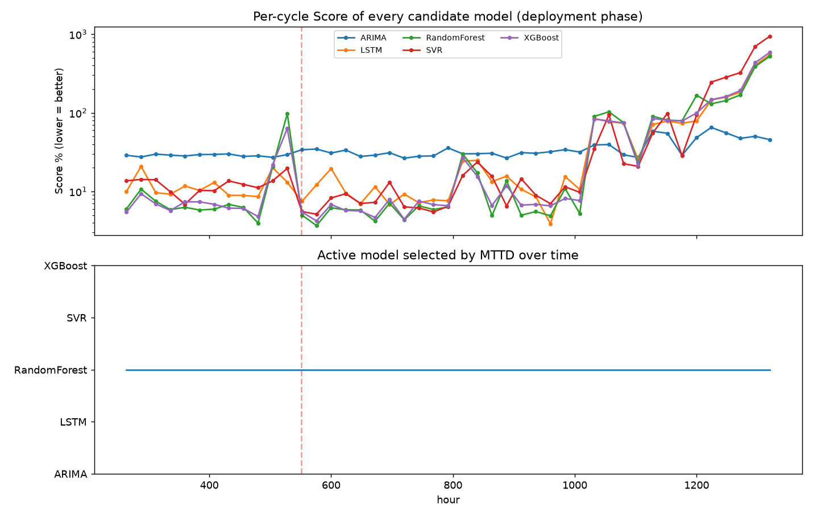
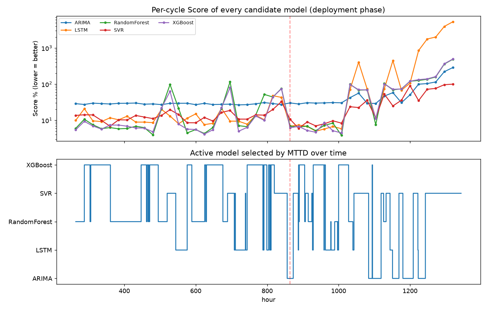
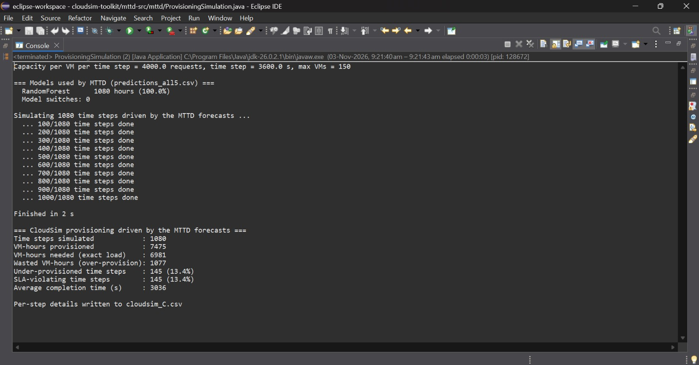

# Machine Learning Workload Prediction in Cloud Environments

**Reproducing and Extending the MTTD Dynamic Model-Selection Framework: Five ML Models on a 2023 Cricket World Cup Workload with CloudSim Evaluation**

[](https://www.python.org/downloads/)
[](LICENSE)
[](https://www.nature.com/articles/s41598-026-40777-z)
[](paper/MTTD_CloudSim_Cricket_WC2023_Research_Paper.pdf)

**Authors:** Abhinav Mishra, Garv Gujral, Shashank Yadav
**Affiliation:** Netaji Subhas University of Technology, New Delhi 110075, India

---

## 1. Overview

Nashaat et al. (*Scientific Reports*, 2026, [doi:10.1038/s41598-026-40777-z](https://www.nature.com/articles/s41598-026-40777-z)) proposed **MTTD** (Monitor–Train–Test–Deploy): train several workload predictors, deploy the one with the lowest error score, and retrain when an adaptive threshold is breached on two consecutive cycles. They used three models (ARIMA, SVR, Random Forest) and FIFA World Cup server logs.

This repository reproduces MTTD and extends it:

| | Original paper | This repository |
|---|---|---|
| Models | ARIMA, SVR, Random Forest | Same three **+ XGBoost + LSTM (PyTorch)** |
| Data | FIFA World Cup 1998 / 2018 server logs | **2023 ICC Cricket World Cup** Wikipedia page views (user traffic), expanded to hourly |
| Model switching | Re-choose the model only after two-strike retraining | Same, **plus optional periodic reselection** every N hours (`--reselect-every`) |
| Evaluation | Prediction accuracy (RMSE, MAE, Score) | Accuracy (+ MAPE on synthetic data) **and a CloudSim provisioning simulation** |

---

## 2. Pipeline

```
data/cricket_hourly_workload.csv (1,344 hours)
        │
        ▼
mttd_bridge.py  ── Stage 1: MTTD in Python ─────────────────────────────────────
  Monitor : collect hourly load
  Train   : fit ARIMA, SVR, Random Forest, XGBoost, LSTM on the last 240 h
            (window-based models use the last 24 hourly values as input)
  Test    : score every model on the last 24 h; lowest Score becomes active
  Deploy  : forecast hour by hour in 24-h cycles; retrain + re-test after
            two consecutive threshold breaches
  (option) --reselect-every N : also re-choose the active model every N hours
            from the last 24 h of logged forecasts
        │  predictions CSV: hour, actual, predicted, active_model, retrain_event
        ▼
cloudsim/ProvisioningSimulation.java ── Stage 2: CloudSim ──────────────────────
  VMs = ceil(1.10 × forecast / C), C = 4,000 requests per VM-hour (CloudSim 3.0.3)
  run the hour's real requests as cloudlets; SLA violated if not done in 3,600 s
```

**Score** (Eq. 4 of the base paper, `arima_baseline.performance_score`):

```
Score = 100 × ( 0.5 × RMSE / sqrt(mean(y²)) + 0.5 × MAE / mean(y) )      lower is better
```

**Two-strike retraining:** after a healthy cycle the next threshold is `Score × 1.75`; after a first breach it is `Score × 1.5`; two consecutive breaches trigger retraining of all five models and a new test-phase selection.

---

## 3. Dataset

Daily page views of the English Wikipedia article *2023 Cricket World Cup* (Wikimedia Pageviews tool, agent = user, 1 Oct – 25 Nov 2023, 56 days) are expanded to 1,344 hourly values: 70 % of each day in the match window 14:00–21:59, 30 % in the other 16 hours, ±8 % uniform noise, rescaled so every day keeps its real total (seed 42). Only the daily totals are measured; the hourly shape is modelled. Details: [`data/README.md`](data/README.md).

| Total | Peak hour | Deployment window |
|---|---|---|
| 29,957,762 requests | 117,612 at 17:00, 19 Nov 2023 (the Final) | hours 264–1343 (1,080 h), mean 23,737 per hour |

---

## 4. Project structure

```
├── data/
│   ├── raw/pageviews-2023-10-01-2023-11-25.csv   # daily page views (real)
│   ├── build_hourly_workload.py                   # daily → hourly (seed 42)
│   ├── cricket_hourly_workload.csv                # 1,344-hour trace used in all runs
│   └── verify_dataset.py                          # row count, timestamps, daily totals, SHA-256
├── mttd_bridge.py                 # MTTD loop on the cricket trace (+ --reselect-every)
├── cloudsim/
│   ├── ProvisioningSimulation.java    # CloudSim replay of the forecasts
│   └── README.md
├── arima_baseline.py              # ARIMA + RMSE, MAE, MAPE, Score
├── svr_rf_models.py, xgboost_model.py, lstm_model.py, sliding_window.py
├── model_selector.py              # test-phase model selection (synthetic benchmark)
├── deployment_manager.py          # two-strike threshold logic (Eq. 5–6)
├── predictors.py                  # streaming predictor wrappers
├── synthetic_workload.py, run_benchmark.py    # synthetic benchmark (4 patterns)
├── results/
│   ├── cricket/                   # MTTD predictions, scores, plots, CloudSim outputs
│   ├── tables/, figures/, logs/   # synthetic benchmark
│   └── README.md
├── tools/results_to_markdown.py   # prints result tables as markdown
├── tests/                         # pytest suite
└── paper/                         # research paper (PDF + LaTeX source)
```

---

## 5. Installation

```bash
git clone https://github.com/garv-codes/ML-workload-prediction.git
cd ML-workload-prediction
python -m venv venv
source venv/bin/activate            # Windows: venv\Scripts\Activate.ps1
pip install torch --index-url https://download.pytorch.org/whl/cpu
pip install -r requirements.txt
```

---

## 6. Usage

```bash
# dataset: rebuild (byte-identical) and verify
python data/build_hourly_workload.py
python data/verify_dataset.py

# MTTD on the cricket trace
python mttd_bridge.py --csv data/cricket_hourly_workload.csv --out results/cricket/predictions_all5.csv
python mttd_bridge.py --csv data/cricket_hourly_workload.csv --out results/cricket/predictions_daily.csv  --reselect-every 24
python mttd_bridge.py --csv data/cricket_hourly_workload.csv --out results/cricket/predictions_hourly.csv --reselect-every 1

# CloudSim: see cloudsim/README.md

# synthetic benchmark (5 models / original 3 models)
python run_benchmark.py
python run_benchmark.py --original-only

# tests
python -m pytest -q
```

---

## 7. Results

### 7.1 Synthetic benchmark (Score %, MAPE in brackets)

697 minutes, 70/30 split, 100-point test window, window 5 — `results/tables/grand_summary.csv`.

| Model | Uniform | Linear low | Linear high | Random |
|---|---|---|---|---|
| ARIMA | **1.51** (1.42 %) | **0.49** (0.44 %) | **0.08** (0.07 %) | **3.63** (3.28 %) |
| SVR | 11.11 (11.49 %) | 50.95 (49.73 %) | 54.28 (54.05 %) | 7.73 (7.00 %) |
| Random Forest | 3.95 (3.96 %) | 10.56 (9.61 %) | 10.25 (9.29 %) | 3.96 (3.66 %) |
| XGBoost | 4.35 (4.31 %) | 10.46 (9.51 %) | 10.28 (9.32 %) | 3.83 (3.55 %) |
| LSTM | 3.70 (3.80 %) | 2.29 (2.17 %) | 2.14 (2.06 %) | 3.69 (3.40 %) |

### 7.2 Standard MTTD on the cricket trace

| Test window | RF | XGBoost | LSTM | SVR | ARIMA | Selected |
|---|---|---|---|---|---|---|
| Initial (hours 240–263) | **6.49** | 7.07 | 7.55 | 11.75 | 29.18 | Random Forest |
| Retrain at hour 552 | **5.42** | 7.15 | 9.44 | 7.48 | 33.26 | Random Forest |

Random Forest stayed active for all 1,080 hours: Score **32.78 %**, RMSE 13,649.96, MAE 5,945.88. Ten threshold breaches led to one retraining event; eight single breaches were absorbed.

| Candidate | Overall Score % | Cycles with lowest score (of 45) |
|---|---|---|
| SVR | 22.41 | 10 |
| LSTM | 29.72 | 3 |
| ARIMA | 30.61 | 8 |
| XGBoost | 30.66 | 10 |
| Random Forest (active) | 32.78 | 14 |



### 7.3 Periodic reselection

| Run | Score % | RMSE | MAE | Switches | Retrains | Hours active per model |
|---|---|---|---|---|---|---|
| Standard MTTD | 32.78 | 13,649.96 | 5,945.88 | 0 | 1 (hour 552) | RF 1,080 |
| Daily (`--reselect-every 24`) | 21.41 | 8,412.83 | 4,239.58 | 27 | 0 | XGB 312, SVR 312, RF 168, LSTM 144, ARIMA 144 |
| Hourly (`--reselect-every 1`) | 18.96 | 7,757.50 | 3,536.08 | 77 | 1 (hour 864) | XGB 320, SVR 289, RF 235, LSTM 118, ARIMA 118 |



### 7.4 CloudSim 3.0.3 provisioning (1,080 hours; VM-hours needed for the exact load = 6,981)

| Run | VM-hours | Wasted VMh | Under-prov. hours | SLA-violating hours | Avg completion (s) |
|---|---|---|---|---|---|
| Standard MTTD | 7,475 | 1,077 | 145 | 145 (13.4 %) | 3,036 |
| Daily reselection | 6,802 | 460 | 263 | 263 (24.4 %) | 3,501 |
| Hourly reselection | 7,312 | 702 | 158 | 158 (14.6 %) | 3,324 |



### 7.5 Key observations

- Random Forest was selected at the test phase and again at the only retraining event, so it stayed active for all 1,080 hours, although the best-scoring model changed between cycles.
- Periodic reselection made the active model switch 27 (daily) and 77 (hourly) times across all five models and lowered the Score to 21.41 % and 18.96 %.
- In CloudSim, hourly reselection cut wasted VM-hours from 1,077 to 702 but raised SLA-violating hours from 145 to 158; daily reselection provisioned fewer VM-hours than needed and violated the SLA in 263 hours. Every SLA-violating hour was an under-provisioned hour.

---

## 8. Reproducibility

- The dataset rebuilds byte-identically (`data/verify_dataset.py` checks the SHA-256).
- The committed cricket results were produced on a Windows machine (JDK 26 for CloudSim). Rerunning `mttd_bridge.py` elsewhere can change LSTM-related numbers slightly, because PyTorch training is not bit-identical across platforms; ARIMA, SVR, Random Forest and XGBoost results are reproducible.
- CloudSim 3.0.3 results are deterministic for the same prediction CSV files; rerunning `cloudsim/ProvisioningSimulation.java` reproduces `results/cricket/cloudsim/cloudsim_*.csv` exactly.

## 9. Limitations

- Only the daily totals are measured; the hourly profile and noise are modelled.
- Wikipedia page views are a proxy for user traffic, not server request logs.
- One tournament, one noise seed and one train/test configuration.
- `GridSearchCV` uses ordinary k-fold rather than time-ordered splits; ARIMA is non-seasonal.
- VM capacity is fixed at 4,000 requests per hour; VM start-up time is not modelled and decisions are hourly.

## 10. Paper

[`paper/MTTD_CloudSim_Cricket_WC2023_Research_Paper.pdf`](paper/MTTD_CloudSim_Cricket_WC2023_Research_Paper.pdf) (LaTeX source in `paper/latex_source/`)

> A. Mishra, G. Gujral, S. Yadav, "Reproducing and Extending the MTTD Dynamic Model-Selection Framework: Five ML Models on a 2023 Cricket World Cup Workload with CloudSim Evaluation," Netaji Subhas University of Technology, 2026.

Base paper: M. Nashaat *et al.*, "A dynamic machine learning approach for workload prediction in cloud environments," *Scientific Reports*, vol. 16, art. 10983, 2026.

## License

[MIT](LICENSE)
